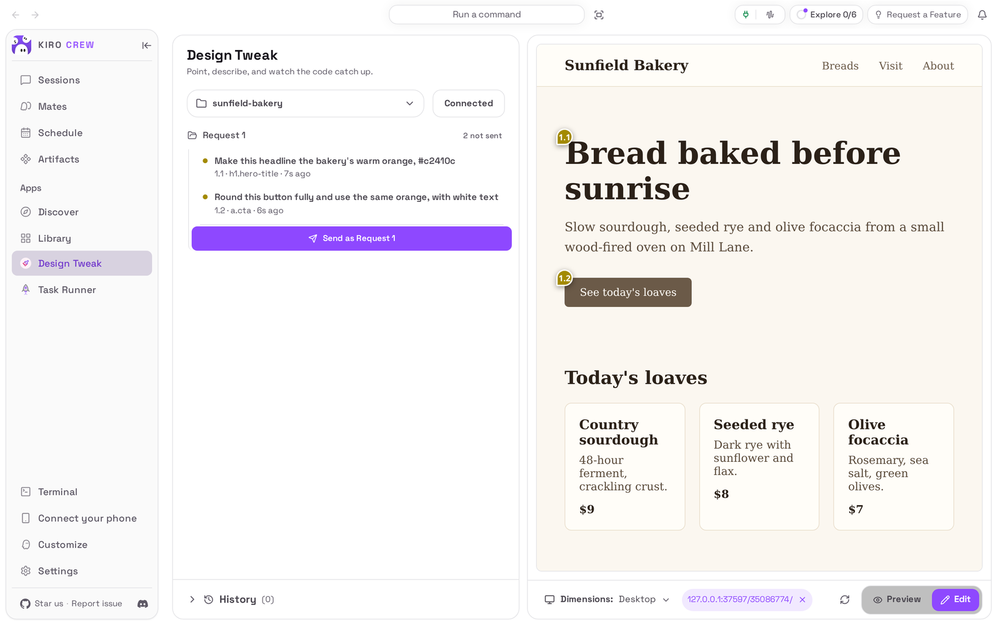
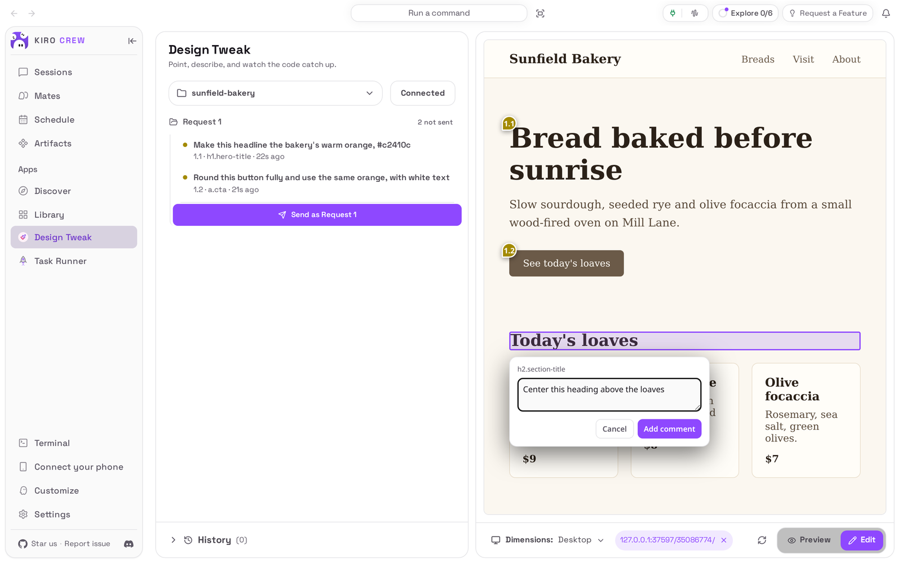
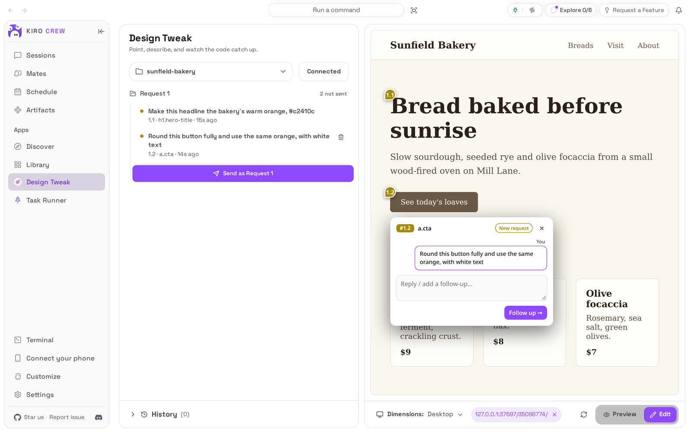
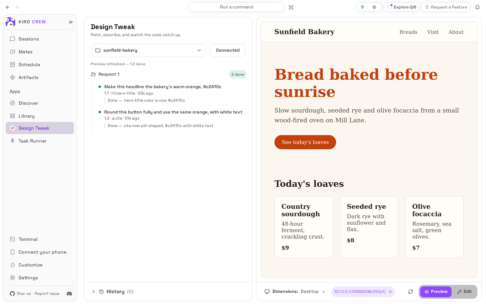

# Design Tweak

<picture>
  <source media="(prefers-color-scheme: dark)" srcset="docs/media/hero-dark.png">
  
</picture>

**Point at what should change in your web app, say how, and the agent edits the code.**

Design Tweak is an app for [Kiro Crew](https://github.com/kirodotdev/KiroCrew),
the open-source personal AI agent.

## What it is

Design Tweak adds a **Design Tweak** page to Kiro Crew's sidebar. It shows a live
preview of a web project on your computer. In **Edit** mode you right-click any
part of the page and write what should change; the comments collect into a
request, and when you send it, the agent edits the project's files, one comment at
a time, and marks each one done. The preview reloads to show the result.

**Get started:** open **Apps → Library**, choose **Show N disabled apps**, and
choose **Enable** on **Design Tweak** (see [Install](#install)).

## The problem it solves

Asking an AI agent for a visual change usually means describing where things are:
"the button in the top section, under the second paragraph, the brown one". It
guesses, edits the wrong rule, and you go round again. Design Tweak lets you point
instead. Each comment carries the element you clicked, where it sits on the page
and the file being previewed, so the agent goes to the right place in your code.
You collect several changes before sending them, and you can see which ones are
done. It does not publish or deploy anything: it changes files in your project
folder and nothing else.

## Top 3 use cases

### 1. Point at the thing, instead of describing it

You are polishing a landing page and the heading above the product cards should
be centred. You switch the preview to **Edit**, right-click the heading, and type
the change in the box that opens next to it. The heading is outlined, so you can
see exactly what the comment is about.



### 2. Collect a batch of small fixes, then send them together

You walk through the page and leave a comment on everything that bothers you: the
headline colour, the shape of the button. Each one is numbered (**1.1**, **1.2**)
and pinned to its element in the preview, and nothing is sent until you choose
**Send as Request 1**. Click a comment in the list to open its note on the page.



### 3. Watch each change land

You send the request. The agent works in a chat session of its own for this
project, asks before it acts on your computer, and reports on each comment as it
goes. When a comment is done its dot turns green with the agent's one-line note
under it, and the preview reloads with the change.



## Watch it


[Watch the walkthrough as a video (MP4)](docs/media/walkthrough.mp4).

<sub>Recorded from a real Kiro Crew dashboard on a throwaway home, running this
repository's own copy of the app (commit `f86e45f`), installed from a clone. The
Kiro Crew was the App Kit level-1 commit `99161724c0` with only its built-in copy
of this app removed, because a Kiro Crew that ships it refuses a second install.
The previewed site is a made-up bakery written for this README; its first two
comments were added through the app's own API before recording. The edits and
the agent's notes come from a live AI model and will vary from run to run; in
this run the agent first asked to run a command that lists the waiting requests,
and trusting the session let it continue. The waits while the agent starts and
while it works (about 13 and 25 seconds) are shortened in the video.</sub>

## Install

**Today: Design Tweak comes with Kiro Crew.** Nothing needs downloading. It
starts switched off:

1. In Kiro Crew, open **Apps → Library** in the left sidebar.
2. Choose **Show N disabled apps** (N is how many apps are switched off).
3. On the **Design Tweak** tile, open the **⋯** menu and choose **Enable**.
4. **Design Tweak** now appears under **Apps** in the sidebar.

**Coming soon: from the Kiro Crew App Store.** Once this app is listed there:

1. Open **Apps → Discover** in the left sidebar.
2. Search for **Design Tweak** and choose **Install**.
3. Kiro Crew asks **Trust “Design Tweak” to run its own code?** Design Tweak
   runs a small program of its own that serves the preview, keeps your comments
   and starts your project's dev server when you ask it to. Trusting it gives that
   program the same access Kiro Crew has (your files, your saved sign-ins and the
   internet), as the dialog says. If you are happy with that, choose **Trust this
   app**. You can take it back later in **Settings → Security → Third-party apps**.
   Kiro Crew also shows what the page may reach: the app's own program and your
   chat sessions, because each request is sent into a chat session of its own.
4. The app installs switched off. Choose **Enable** on its page.

What you need: Kiro Crew on a Mac, Linux or Windows computer, and Kiro Crew must
already be able to chat (if ordinary chats work, the agent can take requests). A
plain HTML and CSS folder previews as it is. A project built with a framework
(Vite, React, Next and the like) needs its dev server: Design Tweak can start it
for you if Node.js and the project's packages are installed (`npm install` has
been run), or use one you already started.

## First run

The page opens with an empty project list: **No web apps loaded yet.** Open the
dropdown at the top, choose **Load new app**, and pick your project's folder. On
a Mac this opens the usual folder picker; on Linux and Windows, type the folder's
path and choose **Add**. The project appears in the dropdown and its preview
shows on the right. Choose **Connect** if it is not already connected.

## How to use it

1. **Pick the project.** Choose it in the dropdown at the top of the page. Each
   project keeps its own requests, history and chat session.
2. **Switch to Edit.** Use the **Edit** switch at the bottom right of the
   preview (**Preview** puts it back to a normal page you can click through).
3. **Comment.** Right-click the part of the page you want changed, type what
   should change, and press **Enter** (or choose **Add comment**). The comment
   joins the current request as a numbered item, such as **1.1**, and gets a pin
   on the page. Add as many as you like; you can navigate to other pages of the
   site in between.
4. **Send.** Choose **Send as Request 1** (the number counts up per project).
   Once sent, a request is closed: your next comment starts a new one.
5. **Let the agent work.** The request goes to this project's own chat session.
   The agent asks before it runs a tool or edits a file, as every Kiro Crew chat
   does: open the session with the chat icon on the request's row (it appears when
   you point at the row) and choose **Allow once**, or trust the session to let it
   continue on its own.
6. **Check the result.** Back on **Design Tweak**, each comment shows the agent's
   progress notes and turns green when it is done; the preview reloads on its own.
   To refine a finished change, open its pin and write a follow-up: it becomes a
   new comment linked to the original.
7. **Tidy up.** Before you send, the bin icon next to a comment removes it from
   the request. After you send, the request's **⋯** menu (it appears when you
   point at the row) offers **Archive to History** and **Delete request**.
   **History** at the bottom of the list keeps archived requests.

Other controls: **Dimensions** at the bottom switches the preview between
**Desktop**, **Tablet** (768 px) and **Mobile** (390 px); the refresh button
reloads it; **Dev server** points a project at a dev server you already run, or
starts its own.

## Settings & data

- **Where your data lives:** the list of projects, the requests waiting to be
  worked and the archived ones are kept in `~/.kiro/crew/apps/design-tweak/data/`
  (under `$KIROCREW_HOME` if you set it). Your project's files stay where they
  are; the agent edits them in place, so keep the project in version control.
- **What leaves your computer:** your comments, the element details they carry
  and the request go to the same AI model as the rest of your Kiro Crew, in the
  project's chat session. The preview is served only to this computer.
- **What it never does:** it never serves files that hold credentials (such as a
  `.env` file or a private key) to the preview, refuses to load folders that hold
  them (such as `~/.ssh`), and never runs anything you did not start: it only
  starts a project's dev server when you choose **Start dev server**, and only
  stops servers it started itself.
- **Turn it off:** **Apps → Library**, open the **⋯** menu on Design Tweak,
  choose **Disable**. Your projects and requests are kept.
- **Remove it** (once it is installed from the App Store): the same menu,
  **Uninstall**. **Keep app data** is ticked by default; untick it to delete the
  data too. The copy that comes with Kiro Crew can be switched off but not
  removed.

## Troubleshooting / FAQ

**"This is a web app — it needs a dev server"**
The project is built with a framework, so its files cannot be shown straight from
disk. Choose **Start dev server**, or start it yourself and choose **Dev server**
so Design Tweak can find it.

**"node_modules is missing — run `npm install` in … first."**
The project's packages are not installed yet, so its dev server cannot start.
Install them in that folder, then choose **Start dev server** again.

**"Could not find `npm`…"**
Design Tweak looks for Node.js in the usual install places and did not find it.
Start the dev server yourself, then choose **Dev server** to connect to it.

**"Preview not reachable"** or **"Nothing answered at …"**
Nothing is answering at the project's address. Start its dev server and choose
**Retry**, or clear the dev-server address to preview the files from disk.

**"The app backend did not answer."**
Design Tweak's own program is not running. Turn the app off and on again in
**Apps → Library**.

**The folder picker does not open.**
The picker exists only on a Mac. Type the folder's path and choose **Add**.

**A request stays in progress.**
The agent is probably waiting for you. Open the session with the chat icon on
the request's row and answer its question.

**"Request N is ready but this app has no folder…"**
The request has no project folder, so there is no session to send it to. Set the
project's folder, then send it from the list.

## Development

This repository is the externally packaged form of the `design-tweak` app that
ships built into Kiro Crew. The two share a name, a version and their data
folder, so the Kiro Crew release that adds built-in adoption can move an existing
built-in install onto this source in place, at a commit pinned in that release.
Until a user's Kiro Crew does that, it keeps running its built-in copy, and
nothing here changes what they run. [PORTING.md](PORTING.md) lists every place
this copy differs from the built-in, why, and what Kiro Crew still has to change.

| Path | What it is |
|---|---|
| `app.json` | The app manifest: the spawned backend, the `ui` entry and the `l10n` listing copy |
| `backend/server.py` | The backend the gateway starts (`backend.entryPoint`): a loopback HTTP server behind the gateway's signed proxy at `/apps/design-tweak/api/*` |
| `backend/http_api.py`, `request_state.py`, `preview_files.py`, `dev_preview.py` | Its routes, the project registry and request queue, the static preview servers, and dev-server discovery with the injecting proxy |
| `backend/_host.py` | Everything the backend takes from Kiro Crew, each name feature-detected with a stand-in that refuses |
| `inject/select-to-edit.js` | The overlay injected into the previewed page (Edit mode, pins, comment boxes) |
| `skills/visual-edit/` | Teaches the agent to work a request and report per comment |
| `ui/src/` | The dashboard page (React), built against `@kirocrew/app-sdk` |
| `ui/i18n/` | The page's strings in every language the dashboard ships |
| `ui/dist/index.mjs` | The built page, **committed**: an install is a plain clone with no build step |
| `ui/tests/` | UI tests (vitest + jsdom), with light stand-ins for the host SDK |
| `assets/` | Store icon, hero art and screenshot (raster, as the catalog requires) |
| `tests/` | Backend and manifest tests, runnable offline with pytest |
| `capture/` | Captures the README media from a real, isolated Kiro Crew ([capture/README.md](capture/README.md)); `demo_site.py` writes the made-up site it previews |
| `docs/media/` | The README pictures and walkthrough, plus `media.json` (sizes, alt text, commits) |

### What it needs from Kiro Crew

Kiro Crew 0.12.0 or later (`minKiroCrewVersion`). The backend runs under the
gateway's own Python and uses only the standard library plus a few Kiro Crew
functions that have no published App Kit surface for an app's own process yet:
the proxy signature check, the credential-path check, the link-safe file read,
the redaction of secrets from text, the security event log, and the helpers that
list listening ports and stop a process tree. `backend/_host.py` imports each one
inside a guard; when one is missing the app refuses that capability rather than
working without it, and `/health` names it under `hostGaps`. The agent reports
progress through Kiro Crew's `design_tweak_update_thread` tool, which still lives
in Kiro Crew (PORTING.md, gap 3).

### Install from a clone

```bash
git clone https://github.com/KiroCrewCaptain/kirocrew-app-design-tweak
kirocrew app install ./kirocrew-app-design-tweak
```

A Kiro Crew that still ships the built-in `design-tweak` refuses this install
under the same name. `kirocrew app enable design-tweak` is refused with
`app_execution_denied` until the app is trusted, and there is no command-line
trust step. Enable it from **Apps → Library** instead: that opens the trust
dialog, and **Trust this app and enable** does both.
`kirocrew app disable design-tweak` turns it off;
`kirocrew app uninstall design-tweak` keeps the data and adding `--purge-data`
deletes it.

### Tests

```bash
python -m pip install -r tests/requirements.txt
python -m pytest                      # against tests/host_double.py, no Kiro Crew needed
KIROCREW_SRC=/path/to/KiroCrew/src python -m pytest   # against the real host (needs its dependencies)
cd ui && npm ci && npm run typecheck && npm test && npm run build
```

CI runs both backend forms, the UI suite, and checks that `ui/dist/index.mjs` is
exactly what `npm run build` produces.

### Re-capture the README media

The pictures and the recording come from a real, isolated Kiro Crew gateway
driven by [`capture/`](capture/README.md). After any change to what the app shows:

```bash
python capture/capture.py --kirocrew /path/to/KiroCrew
python capture/check_readme.py
```

Run it from a clean clone, on a Kiro Crew without the built-in copy (see the
provenance note above). The use case 3 picture and the walkthrough run on your
own signed-in `kiro-cli`. Then look at every image and at a few frames of the
video before committing (see [CHECKLIST.md](CHECKLIST.md)).

## License

Apache License 2.0. See [LICENSE](LICENSE) and [NOTICE](NOTICE).
